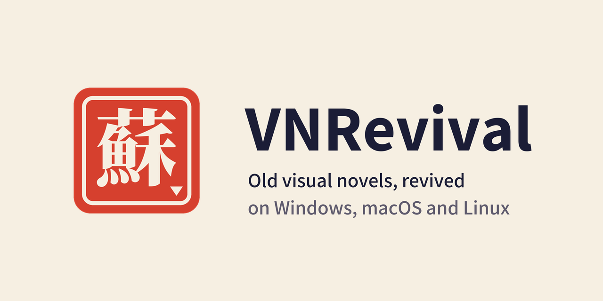
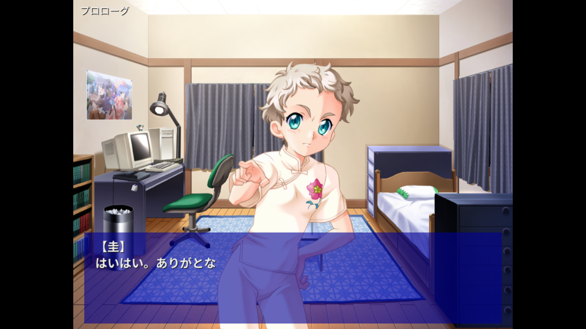
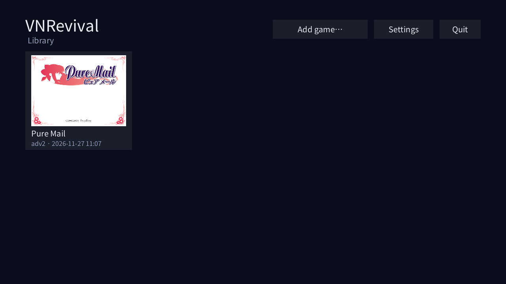
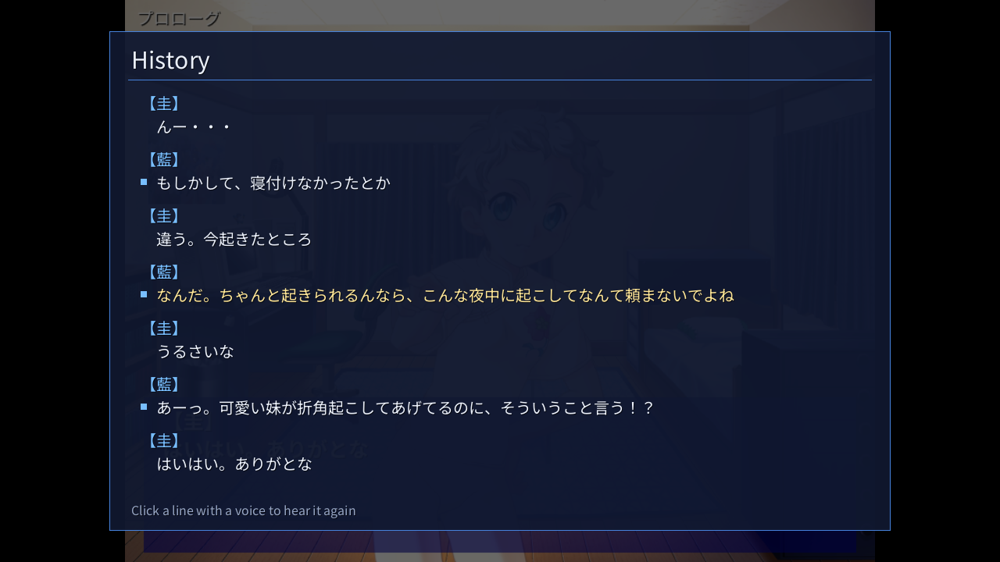
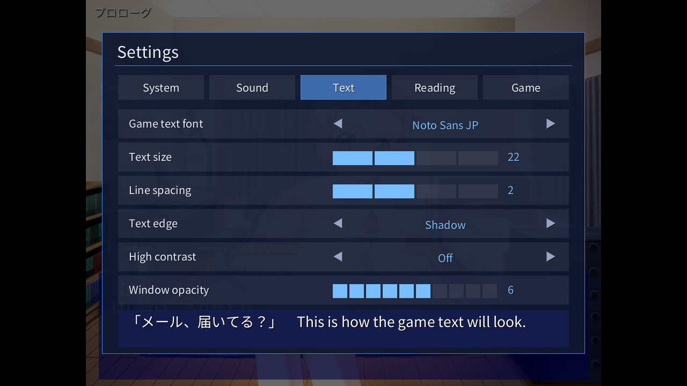

<p align="center">
  
</p>

<p align="center">
  <a href="https://yamato6.github.io/VNRevival-web/"></a>
  <a href="https://github.com/Yamato6/VNRevival/releases/latest"></a>
  <a href="https://github.com/Yamato6/VNRevival/actions/workflows/ci.yml"></a>
  <a href="LICENSE"></a>
</p>

**VNRevival** plays old visual novels on today's computers. Their
original engines were made for Windows 98 and often no longer run on
current systems, or run badly. VNRevival is a new engine that
reimplements them: it reads the data files of **your own copy** of a game
and plays its original scripts on Windows, macOS and Linux, much as
[ScummVM](https://www.scummvm.org/) does for adventure games.

VNRevival does not come with any game. You need a legal copy of the game.

Downloads, the user manual and the developer notes are also on the
**[website](https://yamato6.github.io/VNRevival-web/)**.

<table>
  <tr>
    <td></td>
    <td></td>
  </tr>
  <tr>
    <td></td>
    <td></td>
  </tr>
</table>

## Features

* **Runs the original scripts.** Each supported engine is reimplemented
  from its own bytecode, with the original timings, music, voices and
  movies.
* **Windows, macOS and Linux.** One program with no installer that keeps
  the picture's shape in any window size or full screen.
* **One interface for every game.** A game library, save anywhere with
  10 slots per game, a message history that replays voices, auto mode,
  and skipping that stops at text you have not read yet.
* **Extras.** A CG gallery, a music room and scene replay. Progress made
  in the original game counts.
* **Easy to read.** Modern Japanese fonts, adjustable text size and line
  spacing, outlined text, a high-contrast mode, and window opacity.
* **Interface in English, Spanish and Japanese**, with your own wording
  possible for each.

## Supported games

| Engine | Games | Status |
|---|---|---|
| OverflowADV2 | Pure Mail (Overflow, 2001), DVD edition | Playable on its original scripts; some effects and engine functions are still missing |

More engines are planned. If you would like a game supported, open a
[game request](https://github.com/Yamato6/VNRevival/issues/new/choose).

## Download and play

1. Download the package for your system from the
   [latest release](https://github.com/Yamato6/VNRevival/releases/latest):
   a `.zip` for Windows, a `.dmg` for macOS (Intel and Apple Silicon), or
   an `.AppImage` or `.tar.gz` for Linux.
2. Open VNRevival and click **Add game…**, then choose the folder where
   your game is installed.
3. Click the game to play.

The **[user manual](docs/MANUAL.md)** explains everything else:
controls, saves, settings, where your files are kept, and what to do if
something goes wrong.

## Building from source

You need Rust 1.85 or newer, CMake and a C compiler (SDL2 is built in
statically).

```sh
git clone https://github.com/Yamato6/VNRevival
cd VNRevival
cargo run --release
```

**[docs/DEVELOPING.md](docs/DEVELOPING.md)** covers the architecture,
the per-system dependencies, tests with real game data, the command
line, and how releases are made. Format readers live in the companion
project **[VNTools-rs](https://github.com/Yamato6/VNTools-rs)**, which
also has extraction tools and reverse-engineering notes.

Contributions are welcome. Please read
[CONTRIBUTING.md](CONTRIBUTING.md) first.

## Roadmap

1. ✅ OverflowADV2 formats in VNTools-rs: images, audio, script bytecode, Indeo 5 video.
2. ✅ Runtime core: window, rendering, input, Japanese text, audio
   mixing, and headless runs for tests.
3. 🚧 Pure Mail complete: the remaining engine functions and effects.
4. ✅ Universal interface: library, menus, saves, history, settings,
   extras, accessibility, interface languages.
5. Mods and translations.
6. More engines.

## License

VNRevival is released under the [MIT license](LICENSE). Release
packages include Noto Sans JP under the SIL Open Font License.

Game names, pictures and trademarks belong to their owners; the
screenshots above show a copy of Pure Mail © Overflow. This project is
not affiliated with Overflow or any other developer or publisher.
